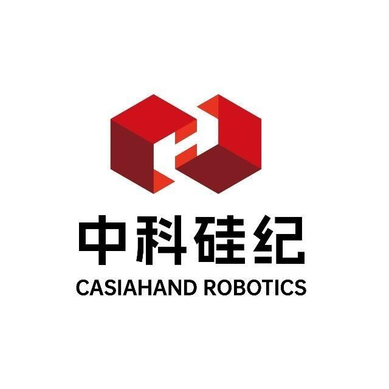

# multi_teleop 数据手套遥操作系统

<p align="center">
  
</p>

`multi_teleop` 是面向 Windows x64 的数据手套遥操作软件。系统采集数据手套的手部传感信息，完成标定、滤波、学习映射和意图处理后，将统一的手部控制量同时用于 MuJoCo 仿真验证与真实机械手控制。

当前生产方案以中科硅纪光纤数据手套为主要输入设备，并保留多种手模型和机械手控制器。CH-M6 与 CH-3 结构不同，使用相互独立的学习流程，避免一种手型的训练结果覆盖另一种手型。

## 核心能力

- 数据手套发现、左右手选择、连接、基础标定和状态显示。
- MuJoCo 手模型仿真、关节限位和实时动作同步。
- CH-M6 六控制量自动标定：单调 PWL `K=3`、固定 Lasso backbone、Dense LoRA `rank=4`。
- 按手套序列号和左右手保存、匹配 per-glove 校正模型。
- CH-M6 食指捏合、中指捏合、拇指位于食指与中指之间、握拳等意图与柔性吸附。
- CH-3 独立三指学习，只更新 CH-3 对应的仿真和实机映射。
- 多机械手串口控制、数据记录和中英日界面资源。

## 当前数据链路

CH-M6 的六维控制语义依次为：拇指旋转、拇指弯曲、食指弯曲、中指弯曲、无名指弯曲、小指弯曲。仿真模型虽然包含更多可视关节，但学习目标和实机命令均以这六个主动控制量为基准，其他仿真关节由耦合规则展开。

CH-3 不复用上述六维姿态集。它使用自己的参考姿态、四维实机主动控制量和十关节仿真展开规则。

## CH-M6 统一预设姿态

| 姿态 | 六维目标角度（度） |
|---|---|
| 张开 | `0, 0, 0, 0, 0, 0` |
| 对食指 | `80, 23, 43, 0, 0, 0` |
| 对中指 | `100, 20, 0, 45, 0, 0` |
| 三指捏 | `90, 25, 40, 40, 0, 0` |
| 半握 | `0, 0, 45, 45, 45, 45` |
| 握拳 | `70, 30, 80, 80, 80, 80` |

配置的唯一数据源为 `config/chm6_preset_poses.json`，界面文字、参考图片和文档应与其中的姿态名称保持一致。

## 模型范围

当前代码和配置包含以下主要仿真入口：

- CasiaHand CH-8、CH-M、CH-M6、CH-M11、CH-3
- Inspire Hand、BrainCo Hand、Fourier Hand
- All Hands 联合展示模型

真实机械手能否使用还取决于对应控制器、串口协议、Hand ID、固件和现场接线。新型号不能只添加 MuJoCo XML，还必须补充控制语义、限位、映射及通信验证。

## 文档入口

- [用户使用说明](USER_GUIDE.md)：面向操作人员，包含连接、标定、仿真、实机控制和故障排查。
- [更新日志](CHANGELOG.md)：记录已发布版本和当前尚未发布的生产化修改。
- [生产环境与打包说明](packaging/PRODUCTION_BUILD.md)：面向开发和发布人员，包含精确依赖、构建、目录和验收流程。
- `build/reports/build-report.md`：每次成功构建生成的摘要、环境信息和产物哈希。
- `build/reports/compilation-report.xml`：Nuitka 详细模块、数据文件和 DLL 报告。

## 从源码运行

生产环境固定为 Windows x64 / Python 3.10.19。不要直接使用日常开发环境或未锁定的 `pip freeze`。

```powershell
conda env create --solver classic -f packaging/environment.production.yml
conda activate multi-teleop-production
python -m pip install --no-cache-dir --only-binary=:all: --no-deps -r packaging/requirements-runtime.lock.txt
python -m pip install --no-cache-dir --no-build-isolation --no-deps -r packaging/requirements-build.lock.txt
python -m pip check
python packaging/verify_production_env.py
python new_main.py
```

完整依赖版本位于：

- `packaging/environment.production.yml`
- `packaging/requirements-runtime.lock.txt`
- `packaging/requirements-build.lock.txt`

## 构建生产包

在已经激活并验证的生产环境中执行：

```powershell
build_nuitka.bat
```

成功后，可发布目录为 `build/multi_teleop/`。入口程序为 `multi_teleop.exe`。构建脚本会在生成报告前验证 CPU-only 数值运行时、手套 SDK DLL，以及打包程序中的 PWL/LoRA 训练路径。

## 发布目录

```text
multi_teleop/
├─ multi_teleop.exe       用户入口
├─ README.md              项目说明
├─ USER_GUIDE.md          用户操作说明
├─ CHANGELOG.md           版本更新记录
├─ ui/assets/ZKGJ.jpg     项目品牌图
├─ ui/assets/ZKGJ.ico     Windows 应用图标
├─ config/                可写配置与实机映射
├─ mod/                   可写仿真映射
├─ models/                可写个体学习模型
├─ records/               可写采集与标定记录
├─ calib/                 可写基础标定数据
├─ Logs/                  可写日志
└─ _internal/             只读程序、依赖和仿真资源
```

这是便携式发布结构，应完整解压到普通可写目录后运行。若以后制作安装到 `Program Files` 的安装器，应把配置、模型、记录和日志迁移到用户的 `%LOCALAPPDATA%`，不能继续写入安装目录。

## 配置职责

| 路径 | 作用 |
|---|---|
| `config/chm6_mapping.json` | CH-M6 固定 15→6 Lasso backbone |
| `config/chm6_preset_poses.json` | CH-M6 六个统一标定目标姿态 |
| `config/chm6_intent_v1.json` | CH-M6 意图识别与吸附参数 |
| `config/chm6_meta_mappings.json` | 手套序列号、左右手与个体模型索引 |
| `config/ch3_mapping.json` | CH-3 实机基础映射 |
| `config/ch3_intent_v1.json` | CH-3 意图参数 |
| `mod/joint_mapping.json` | MuJoCo 仿真关节映射与耦合规则 |
| `mod/model_configs.json` | 仿真模型元数据、模型路径和关节范围 |
| `models/glove_correction_*.pt` | 自动标定生成的 per-glove PWL/LoRA 参数 |

修改映射前必须区分：`mod/joint_mapping.json` 面向仿真；`config/*_mapping.json` 面向实机或统一控制空间。CH-M6 自动学习不得覆盖 CH-3 的映射区域。

## 发布前最低验收

1. 生产环境验证和 `pip check` 通过。
2. `build_nuitka.bat` 返回码为 0，构建报告显示训练自检通过。
3. 在没有 Conda/Python 的 Windows 测试机上启动软件。
4. 分别完成单手和双手设备发现、基础标定、MuJoCo 仿真与真实机械手控制。
5. 至少完成一次 CH-M6 自动标定和一次 CH-3 三指学习，并重启验证模型能再次加载。
6. 从中文、空格路径启动，确认配置、模型、记录和日志均写入正确目录。

## 安全与授权

真实机械手测试前应设置低速、限位和急停，先在 MuJoCo 中确认动作方向与范围。设备 SDK、机械手模型、品牌图片及项目源码的复制和对外发布，应遵循各自的授权范围。

仓库目前没有独立的 `LICENSE` 文件，因此不再声明默认采用 MIT 或其他开源许可证；正式对外发布前应由项目负责人明确软件许可证、第三方资源清单和版本号。
